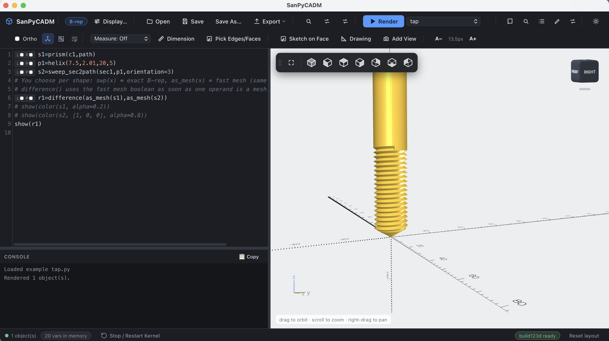
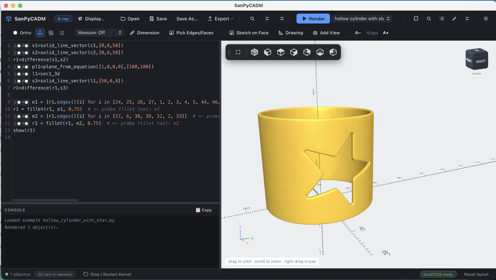
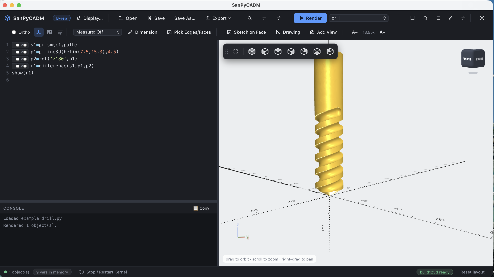

<div align="center">

# SanPyCADM

**SanPyCAD and SanPyCAD Brep in one app: code-first modeling with real B-rep solids, the full ocad library, and mesh speed where you want it.**

[](https://github.com/sprabhakar2006/sanpycadm/releases/latest)
%20%7C%20Windows-0a7bbb)
[](LICENSE)
[](https://www.youtube.com/@sanjeevprabhakar3837/videos)

[Download](#download) · [First model](#your-first-model) · [B-rep or mesh](#choose-per-shape-b-rep-or-mesh) · [Features](#features) · [SanPyCAD](https://github.com/sprabhakar2006/SanPyCAD) · [SanPyCAD Brep](https://github.com/sprabhakar2006/sanpycad-brep)



<sub>A threaded tap: script on the left, live 3D result on the right.</sub>

</div>

---

SanPyCADM is a desktop app for building 3D models with code. Type a script on the left, press **Render**, and the solid appears on the right. It combines the **ocad** geometry library from [SanPyCAD](https://github.com/sprabhakar2006/SanPyCAD) (600+ functions for sweeps, offsets, lofts, B-splines, hulls and more) with the exact B-rep kernel of [SanPyCAD Brep](https://github.com/sprabhakar2006/sanpycad-brep), so you no longer move shapes between two apps.

Shapes that can be exact solids **become exact solids automatically**: real fillets and chamfers, picking edges and faces, STEP export. When an exact result is impractical, such as a 20-turn thread, switch that one shape to a mesh and the boolean finishes in a fraction of a second.

It is a single download. Python, every library, the editor and the 3D viewer are inside, and it runs fully offline.

## Download

| Platform | Download | Open it |
|---|---|---|
| macOS (Apple Silicon) | [**SanPyCADM-mac-arm64.zip**](https://github.com/sprabhakar2006/sanpycadm/releases/latest/download/SanPyCADM-mac-arm64.zip) | unzip, double-click `SanPyCADM.app` |
| Windows 10/11 (x64) | [**SanPyCADM-win-x64.zip**](https://github.com/sprabhakar2006/sanpycadm/releases/latest/download/SanPyCADM-win-x64.zip) | unzip, open the folder, double-click `SanPyCADM.exe` |

All builds are on the [releases page](https://github.com/sprabhakar2006/sanpycadm/releases).

> **First launch.** The app isn't signed by Apple or Microsoft yet, so the first launch shows a warning.
> **macOS:** right-click `SanPyCADM.app` → **Open** → **Open** (once only).
> **Windows:** on the SmartScreen banner, click **More info** → **Run anyway**.

> **Intel Mac or Linux?** There's no prebuilt bundle yet; [run it from source](#run-from-source) instead.

## Your first model

Open the app and press **Render** (or <kbd>Ctrl</kbd>/<kbd>Cmd</kbd>+<kbd>Enter</kbd>) on this script:

```python
a = cube([30, 30, 10], center=True)
b = cylinder(r=8, h=40, center=True)
show(difference(a, b))
```

Both shapes are exact B-rep solids, so you can now click **Pick Edges/Faces**, select the edges of the hole and fillet them.

Now something that is hard in any CAD: a threaded tap. Choose **tap** from the **Examples** dropdown, or write it yourself:

```python
s1 = prism(c1, path)                           # the rod
p1 = helix(7.5, 2.01, 20, 5)                   # thread path
s2 = sweep_sec2path(sec1, p1, orientation=3)   # thread cutter
r1 = difference(as_mesh(s1), as_mesh(s2))      # fast mesh boolean
show(r1)
```

While a script runs, the line being executed is highlighted in the editor, so you can see where a slow step is.

## Choose per shape: B-rep or mesh

| Use | When |
|---|---|
| `swp(x)` | You need an exact B-rep: fillets, chamfers, edge and face picking, STEP export. |
| `as_mesh(x)` | You want speed: long swept solids, threads, springs. Booleans run on [manifold3d](https://github.com/elalish/manifold) and the result is flat-shaded, as in SanPyCAD. |

`difference()` switches to the mesh boolean as soon as one operand is a mesh. If an exact cut silently removes nothing (typical for an invalid multi-turn cutter), it falls back to the mesh boolean and says so in the console. Pass `exact=True` to force the exact cut.

## Examples

<table>
<tr>
<td width="33%" align="center"><br><b>Threaded tap</b><br><sub>helix sweep, fast mesh boolean</sub></td>
<td width="33%" align="center"><br><b>Cylinder with a star cut-out</b><br><sub>exact B-rep, filleted edges</sub></td>
<td width="33%" align="center"><br><b>Drill bit</b><br><sub>helical flutes with <code>p_line3d</code></sub></td>
</tr>
</table>

## How a model usually comes together

1. **Sketch the profile.** Open **2D Sketch**, draw the outline with lines, arcs, tangent arcs and rounded corners, and click **Send to SanPyCAD**. The profile lands in your script as a variable such as `sec1`. To sketch on an existing part, use **Sketch on Face**.
2. **Make it 3D.** `linear_extrude()`, `prism()`, sweeps along a path or a `helix()`, lofts between sections.
3. **Combine.** `union()`, `difference()`, `intersection()`, `hull()`, `split()`.
4. **Refine.** Click **Pick Edges/Faces** to get edge and face indices, apply `fillet()` and `chamfer()`, or auto-pick seams.
5. **Check and export.** Measure, add dimensions, open **Drawing** for front, top and side views, then export STEP, STL, OBJ, SVG or DXF.

## Features

### Automatic B-rep conversion
Stacks of closed cross-sections (from `prism`, `swp`, `sweep_sec2path` and friends) are converted to real B-rep solids when they reach `show()`, `color()`, `union`, `difference`, `intersection`, `hull`, `split`, `fillet` or `chamfer`. Anything that can't be converted safely, such as open sections (surfaces) or ragged data, keeps working as a point list or mesh and is flagged in the console.

### A geometry library built for the hard parts
The full ocad library by Sanjeev Prabhakar, including `fillet_by_offset`, `suggest_fillet_dir`, `extrude_on_plane`, `sweep_placed_sec2path`, `boundary_edges_tri` and `mesh_erode`. Fillets, sweeps, offsets, B-spline and Bezier curves, hulls, projections and intersections.

### Pick Edges / Faces
Click edges and faces in the 3D view to get their indices, hover a chip to highlight it, lock a selection, and auto-pick seams, then apply fillets and chamfers straight from the selection.

### Sketch, variables and GUI Functions
- The **2D Sketch** panel and **Sketch on Face** send profiles into your script.
- The **Variables** panel lists everything in memory, jumps to the line that defined it, and previews any variable as a line or points in the 3D view.
- **GUI Functions** run many library functions from small panels and write real code into the editor.
- The **Find function** palette (<kbd>Cmd</kbd>/<kbd>Ctrl</kbd>+<kbd>K</kbd>) searches by task.

### A notebook-style kernel
Variables persist between renders, so a slow step can run once, be commented out, and everything after it iterated on for free. <kbd>Tab</kbd> completes function names and <kbd>Shift</kbd>+<kbd>Tab</kbd> shows a signature and docs.

### Measure, dimension, draw
Measure vertices and edges, place labelled dimensions, and build **Drawing** sheets with one, three or six views and section cuts, exported as SVG or PDF.

### Get models in and out
Export STL, OBJ, STEP, SVG and DXF. Scripts are plain `.py` files, openable in any editor.

## SanPyCADM, SanPyCAD and SanPyCAD Brep

| | **[SanPyCAD](https://github.com/sprabhakar2006/SanPyCAD)** | **[SanPyCAD Brep](https://github.com/sprabhakar2006/sanpycad-brep)** | **SanPyCADM** (this repo) |
|---|---|---|---|
| Geometry | triangle mesh from point lists | exact B-rep | both: exact B-rep by default, mesh per shape on request |
| Engine | ocad + manifold3d | build123d on OpenCASCADE | ocad + build123d + manifold3d |
| Script style | Python or OpenSCAD-style | Python | Python |
| Moving shapes between apps | send to Brep | receive from SanPyCAD | not needed |

## Known limitations

- No OpenSCAD-text mode and no `fo()`.
- Mesh import (`import_mesh`, `import_profile(s)`) and `resize` are not ported yet.
- Exact B-rep cuts with long, nearly touching multi-turn threads are unreliable in OpenCASCADE; use `as_mesh()` for those.
- Mesh results cannot be filleted or exported as exact STEP.
- Builds aren't signed or notarized yet, hence the first-launch warnings.

## Run from source

For development, or on an Intel Mac or Linux:

```bash
git clone https://github.com/sprabhakar2006/sanpycadm.git
cd sanpycadm
pip install -r requirements.txt
python app.py
```

Requires Python 3.10 or newer. The geometry kernel ships pre-built under `backend/_protected/`. Without `pywebview` the app opens in your default browser instead of its own window.

<details>
<summary><b>Building the downloadable bundle</b></summary>

```bash
pip install pyinstaller
python packaging/build_bundle.py
```

This produces `dist/SanPyCADM.app` (macOS) or `dist/SanPyCADM/` (Windows, Linux), plus a zip, with Python and every dependency inside. PyInstaller can't cross-compile, so build each platform on that platform. Pushing a `v*` tag runs `.github/workflows/build-installers.yml` on GitHub's macOS and Windows runners and attaches both zips to the release.

The packaged app keeps its settings and log (`SanPyCADM.log`) in `~/Library/Application Support/SanPyCADM` on macOS and `%APPDATA%\SanPyCADM` on Windows. The log is the first place to look if something misbehaves.

</details>

## Documentation

- **Find function** palette in the app (<kbd>Cmd</kbd>/<kbd>Ctrl</kbd>+<kbd>K</kbd>), and `brep_function_reference_guide.pdf` in this repo
- **[YouTube channel](https://www.youtube.com/@sanjeevprabhakar3837/videos)**: step-by-step modeling sessions

## Credits

Created by **Sanjeev Prabhakar**. The ocad geometry library does the modeling work: every primitive, fillet, offset, sweep and hull. SanPyCADM is the editor, viewer, sketcher and B-rep layer around it.

Built with [build123d](https://build123d.readthedocs.io/) / OpenCASCADE, [manifold3d](https://github.com/elalish/manifold), [CodeMirror](https://codemirror.net/) and [Three.js](https://threejs.org/).

## License

[MIT](LICENSE)
