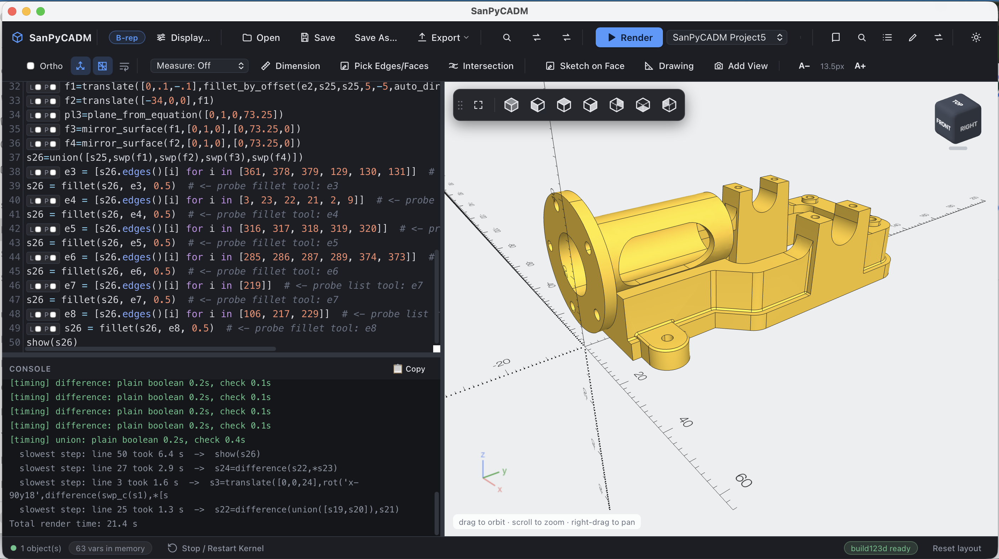

<div align="center">

# SanPyCADM

**SanPyCAD and SanPyCAD Brep in one app: code-first modeling with real B-rep solids, the full ocad library, and mesh speed where you want it.**

[](https://github.com/sprabhakar2006/sanpycadm/releases/latest)
%20%7C%20Windows-0a7bbb)
[](LICENSE)
[](https://www.youtube.com/@sanjeevprabhakar3837/videos)

[Download](#download) · [First model](#your-first-model) · [Examples](#examples-and-video-tutorials) · [B-rep or mesh](#choose-per-shape-b-rep-or-mesh) · [Features](#features) · [SanPyCAD](https://github.com/sprabhakar2006/SanPyCAD) · [SanPyCAD Brep](https://github.com/sprabhakar2006/sanpycad-brep)



<sub>SanPyCADM Project5: script on the left, live 3D result on the right.</sub>

</div>

---

SanPyCADM is a desktop app for building 3D models with code. Type a script on the left, press **Render**, and the solid appears on the right. It combines the **ocad** geometry library from [SanPyCAD](https://github.com/sprabhakar2006/SanPyCAD) (600+ functions for sweeps, offsets, lofts, B-splines, hulls and more) with the exact B-rep kernel of [SanPyCAD Brep](https://github.com/sprabhakar2006/sanpycad-brep), so you no longer move shapes between two apps.

Shapes that can be exact solids **become exact solids automatically**: real fillets and chamfers, picking edges and faces, STEP export. When an exact result is impractical, such as a 20-turn thread, switch that one shape to a mesh and the boolean finishes in a fraction of a second.

It is a single download. Python, every library, the editor and the 3D viewer are inside, and it runs fully offline.

## Download

| Platform | Download | Open it |
|---|---|---|
| macOS (Apple Silicon) | [**SanPyCADM-mac-arm64.zip**](https://github.com/sprabhakar2006/sanpycadm/releases/latest/download/SanPyCADM-mac-arm64.zip) | unzip, double-click `SanPyCADM.app` |
| Windows 10/11 (x64) | [**SanPyCADM-win-x64.zip**](https://github.com/sprabhakar2006/sanpycadm/releases/latest/download/SanPyCADM-win-x64.zip) | unzip, open the folder, double-click `SanPyCADM.exe` |

All builds are on the [releases page](https://github.com/sprabhakar2006/sanpycadm/releases).

> **First launch.** The app isn't signed by Apple or Microsoft yet, so the first launch shows a warning.
> **macOS:** right-click `SanPyCADM.app` → **Open** → **Open** (once only).
> **Windows:** on the SmartScreen banner, click **More info** → **Run anyway**.

> **Intel Mac or Linux?** There's no prebuilt bundle yet; [run it from source](#run-from-source) instead.

## Your first model

Open the app and press **Render** (or <kbd>Ctrl</kbd>/<kbd>Cmd</kbd>+<kbd>Enter</kbd>) on this script:

```python
a = cube([30, 30, 10], center=True)
b = cylinder(r=8, h=40, center=True)
show(difference(a, b))
```

Both shapes are exact B-rep solids, so you can now click **Pick Edges/Faces**, select the edges of the hole and fillet them.

Now a real part. Choose **SanPyCADM Project5** from the **Examples** dropdown (one of 16, see [Examples](#examples-and-video-tutorials)): a multi-part housing built from sketched profiles, swept and extruded bodies, bolt holes and bosses, then finished with `fillet()` and offset fillets. Each stage is a few lines of script:

```python
s9  = difference(union([swp(s6), swp(s7)]), swp(s8), swp(c1))   # body with cut-outs
s25 = union([s3, s24])                                           # join the parts
e1  = [s25.edges()[i] for i in [29, 28]]                         # edges picked in the viewer
s25 = fillet(s25, e1, 1)
show(s25)
```

While a script runs, the line being executed is highlighted in the editor, so you can see where a slow step is.

## Choose per shape: B-rep or mesh

| Use | When |
|---|---|
| `swp(x)` | You need an exact B-rep: fillets, chamfers, edge and face picking, STEP export. |
| `as_mesh(x)` | You want speed: long swept solids, threads, springs. Booleans run on [manifold3d](https://github.com/elalish/manifold) and the result is flat-shaded, as in SanPyCAD. |

SanPyCADM never switches to a mesh behind your back: shapes stay exact B-rep unless you write `as_mesh()`, and `difference()` uses the mesh boolean only when an operand is a mesh. If an exact operation fails or is slow, the console says so, and you can tweak the model:

- **Fewer slices.** `swp(x, slices=60)` keeps the 60 most important sections of a long sweep (spread out, with extra where the shape changes fast), which often turns a failing or very slow build or cut into a quick, valid one. `slices=0` keeps every section.
- **Flat-faced solid.** `swp(x, faceted=True)` builds the solid from flat triangle faces, which OpenCASCADE reads in seconds. It is still a B-rep, but not a smooth surface.
- **Mesh for that shape.** `as_mesh(x)` on both operands runs the fast mesh boolean.

## Examples and video tutorials

The **Examples** dropdown in the toolbar loads **16 ready-made models**. Most come with the 2D sketches they were built from, so you can render one and then read how it was built:

| Example | What it shows |
|---|---|
| `drill` | A twisted drill bit from `p_line3d(helix(...))` |
| `cup` | A turned cup: `prism()`, `split()` and offset lines |
| `hollow_cylinder_with_star` | `solid_line_vector()` extrusions, plane cuts and a star cut-out |
| `split_demo` | Cutting a solid with `split(..., keep="top")` |
| `wavy_tray_fillet` | A wavy tray with an offset-based fillet (`fillet_by_offset`); the model from the SanPyCADM Project 4 video |
| `SanPyCADM Project3` | A plate with a pocket and a pattern of sketched holes, with `fillet()` and `chamfer()` on picked edge lists |
| `SanPyCADM Project5` | A multi-part housing: swept body, bolt holes, bosses, `fillet()` and offset fillets, built step by step |
| `SanPyCADM Project6` | Sphere shells with extruded cut-outs from several 2D sketches |
| `SanPyCADM Project7` | A flat plate from one sketched outline (`clean_profile()`) with sketched holes |
| `SanPyCADM Project8` | Two stacked extrusions with a pattern of sketched holes |
| `SanPyCADM Project9` | A swept, filleted multi-body part: `sweep_sec2path`, `solid_from_2surfaces`, `split`, `fillet` and boolean cuts |
| `SanPyCADM Project10` | A multi-body part: unions of extruded sketches, many sketched cut-outs and pockets, then `fillet()` and `chamfer()` on picked edge lists |
| `SanPyCADM Project11` | A bent, split and filleted bracket: `split()` with a plane, a `surface_line_vector` arm joined by `union`, large `fillet()` radii, then rows of sketched slots cut with `difference` |
| `SanPyCADM Project12` | A pipe fitting: a cylinder joined to a swept branch and a flange with `union`, a hand-built blend at the junction (`o_3d` + `convert_3lines2fillet`), then bores cut with `cylinder` and `difference` |
| `tap` | A threaded tap: `helix()` + `sweep_sec2path()` cutter, fast mesh boolean with `as_mesh()` |
| `brep_tap` | The same tap as an exact B-rep |

Every example is a plain `.py` file in the `examples/` folder, and the sketches that go with it (where it has any) are stored next to it as `<name>.py.sketch.json` and load automatically.

The **[YouTube channel](https://www.youtube.com/@sanjeevprabhakar3837/videos)** has step-by-step modeling sessions recorded in the app itself: the 2D sketch first, then the script written line by line, then Pick Edges/Faces and the fillets.

| Video | Example in the app |
|---|---|
| [SanPyCADM Project 1](https://youtu.be/waSNXv0eEF8) | not included |
| [SanPyCADM Project 2](https://youtu.be/uJZ9jHFqYiQ) | not included |
| [SanPyCADM Project 3](https://youtu.be/7K8bWrsFq4w) | `SanPyCADM Project3` |
| [SanPyCADM Project 4](https://youtu.be/ksuRJgnGJIk) | `wavy_tray_fillet` |
| [SanPyCADM Project 7](https://youtu.be/s36XOSCyl9Y) | `SanPyCADM Project7` |
| [SanPyCADM Project 8](https://youtu.be/fBgigryKavI) | `SanPyCADM Project8` |
| [SanPyCADM Project 9](https://youtu.be/XPLlQ9QJJwA) | `SanPyCADM Project9` |

`SanPyCADM Project5` and `SanPyCADM Project6` are in the Examples dropdown too, and don't have a video yet. Projects 1 and 2 are not included as examples.

## How a model usually comes together

1. **Sketch the profile.** Open **2D Sketch**, draw the outline with lines, arcs, tangent arcs and rounded corners, and click **Send to SanPyCAD**. The profile lands in your script as a variable such as `sec1`. To sketch on an existing part, use **Sketch on Face**.
2. **Make it 3D.** `linear_extrude()`, `prism()`, sweeps along a path or a `helix()`, lofts between sections.
3. **Combine.** `union()`, `difference()`, `intersection()`, `hull()`, `split()`.
4. **Refine.** Click **Pick Edges/Faces** to get edge and face indices, apply `fillet()` and `chamfer()`, or auto-pick seams.
5. **Check and export.** Measure, add dimensions, open **Drawing** for front, top and side views, then export STEP, STL, OBJ, SVG or DXF.

## Features

### Automatic B-rep conversion
Stacks of closed cross-sections (from `prism`, `swp`, `sweep_sec2path` and friends) are converted to real B-rep solids when they reach `show()`, `color()`, `union`, `difference`, `intersection`, `hull`, `split`, `fillet` or `chamfer`. Anything that can't be converted safely, such as open sections (surfaces) or ragged data, keeps working as a point list or mesh and is flagged in the console.

### A geometry library built for the hard parts
The full ocad library by Sanjeev Prabhakar, including `fillet_by_offset`, `suggest_fillet_dir`, `extrude_on_plane`, `sweep_placed_sec2path`, `boundary_edges_tri` and `mesh_erode`. Fillets, sweeps, offsets, B-spline and Bezier curves, hulls, projections and intersections.

### Pick Edges / Faces
Click edges and faces in the 3D view to get their indices, hover a chip to highlight it, lock a selection, and auto-pick seams, then apply fillets and chamfers straight from the selection.

If an OCCT fillet fails, the error now names the edges that don't fit and roughly how large a radius each can take, and `fillet(shape, edges, r, on_fail="skip")` or `on_fail="shrink"` can round what works or retry smaller.

### Offset fillet with live preview
For corners where an OCCT fillet won't work, use **Offset fillet (live preview)** inside the Pick Edges/Faces panel. Pick the edge chain, set an offset for each of the two faces, and the 3D view shows the two offset lines (cyan and orange) with arrows pointing away from the edge, before anything is built. Flip a side with one click, let it detect an outer edge (cut) or inner corner (add) automatically, and remove self-crossing loops at corners. **Apply** writes the `fillet_by_offset(...)` code into the script.

### Profile checks
`linear_extrude()`, `prism()`, `rotate_extrude()` and `extrude_on_plane()` warn in the console when a 2D profile is open or crosses itself, the usual cause of spiky end caps. `clean_profile(sec)` trims the overshoot and closes it, and `check_profile(sec)` reports the problem on its own.

### Sketch, variables and GUI Functions
- The **2D Sketch** panel and **Sketch on Face** send profiles into your script.
- The **Variables** panel lists everything in memory, jumps to the line that defined it, and previews any variable as a line or points in the 3D view.
- **GUI Functions** run many library functions from small panels and write real code into the editor.
- The **Find function** palette (<kbd>Cmd</kbd>/<kbd>Ctrl</kbd>+<kbd>K</kbd>) searches by task.

### A notebook-style kernel
Variables persist between renders, so a slow step can run once, be commented out, and everything after it iterated on for free. <kbd>Tab</kbd> completes function names and <kbd>Shift</kbd>+<kbd>Tab</kbd> shows a signature and docs.

### Measure, dimension, draw
Measure vertices and edges, place labelled dimensions, and build **Drawing** sheets with one, three or six views and section cuts, exported as SVG or PDF.

### Get models in and out
Export STL, OBJ, STEP, SVG and DXF. Scripts are plain `.py` files, openable in any editor.

## SanPyCADM, SanPyCAD and SanPyCAD Brep

| | **[SanPyCAD](https://github.com/sprabhakar2006/SanPyCAD)** | **[SanPyCAD Brep](https://github.com/sprabhakar2006/sanpycad-brep)** | **SanPyCADM** (this repo) |
|---|---|---|---|
| Geometry | triangle mesh from point lists | exact B-rep | both: exact B-rep by default, mesh per shape on request |
| Engine | ocad + manifold3d | build123d on OpenCASCADE | ocad + build123d + manifold3d |
| Script style | Python or OpenSCAD-style | Python | Python |
| Moving shapes between apps | send to Brep | receive from SanPyCAD | not needed |

## Known limitations

- No OpenSCAD-text mode and no `fo()`.
- Mesh import (`import_mesh`, `import_profile(s)`) and `resize` are not ported yet.
- Exact B-rep cuts with long, nearly touching multi-turn threads are unreliable in OpenCASCADE; use `as_mesh()` for those.
- Mesh results cannot be filleted or exported as exact STEP.
- Builds aren't signed or notarized yet, hence the first-launch warnings.

## Run from source

For development, or on an Intel Mac or Linux:

```bash
git clone https://github.com/sprabhakar2006/sanpycadm.git
cd sanpycadm
pip install -r requirements.txt
python app.py
```

Requires Python 3.10 or newer. The geometry kernel ships pre-built under `backend/_protected/`. Without `pywebview` the app opens in your default browser instead of its own window.

<details>
<summary><b>Building the downloadable bundle</b></summary>

```bash
pip install pyinstaller
python packaging/build_bundle.py
```

This produces `dist/SanPyCADM.app` (macOS) or `dist/SanPyCADM/` (Windows, Linux), plus a zip, with Python and every dependency inside. PyInstaller can't cross-compile, so build each platform on that platform. Pushing a `v*` tag runs `.github/workflows/build-installers.yml` on GitHub's macOS and Windows runners and attaches both zips to the release.

The packaged app keeps its settings and log (`SanPyCADM.log`) in `~/Library/Application Support/SanPyCADM` on macOS and `%APPDATA%\SanPyCADM` on Windows. The log is the first place to look if something misbehaves.

</details>

## Documentation

- **Find function** palette in the app (<kbd>Cmd</kbd>/<kbd>Ctrl</kbd>+<kbd>K</kbd>), and `brep_function_reference_guide.pdf` in this repo
- **[YouTube channel](https://www.youtube.com/@sanjeevprabhakar3837/videos)**: step-by-step modeling sessions; the finished models are in the [Examples](#examples-and-video-tutorials) dropdown
- Hover the **build123d ready** badge in the status bar to see the build123d and OpenCASCADE versions

## Credits

Created by **Sanjeev Prabhakar**. The ocad geometry library does the modeling work: every primitive, fillet, offset, sweep and hull. SanPyCADM is the editor, viewer, sketcher and B-rep layer around it.

The packaged app currently bundles **build123d 0.13.0** and **OpenCASCADE (OCCT) 8.0.1** (via `cadquery-ocp-novtk 8.0.1.1.0`). Hover the "build123d ready" badge in the status bar to see the versions of the running install.

Built with [build123d](https://build123d.readthedocs.io/) / OpenCASCADE, [manifold3d](https://github.com/elalish/manifold), [CodeMirror](https://codemirror.net/) and [Three.js](https://threejs.org/).

## License

[MIT](LICENSE)
